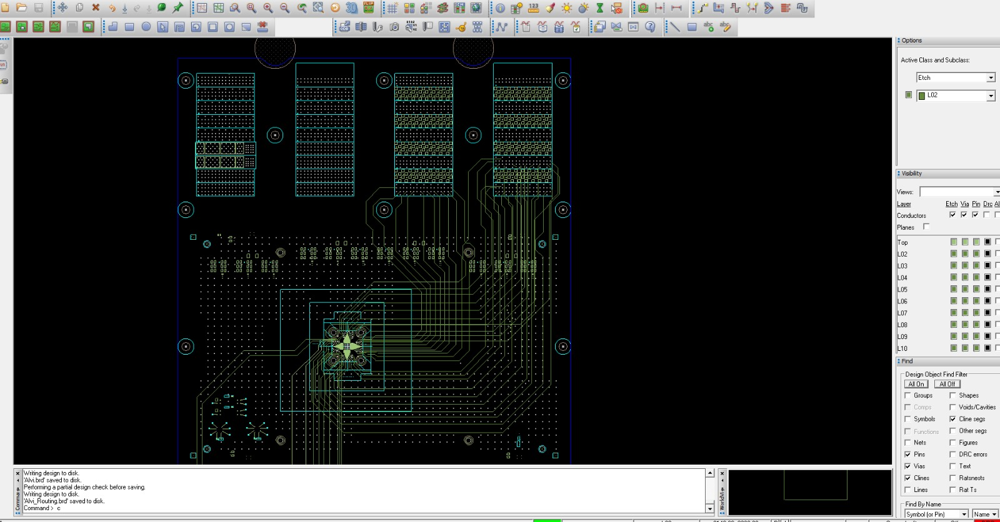

# PCB Design Load Board

This repository contains the Cadence Allegro PCB board file for a **single-sided load board / test fixture**.

## Design Description

The board is a **single-sided load board** used to interface automated test equipment with a device under test (DUT). It routes power, ground, and high-speed signals from the tester to the board's test unit blocks (`UT1`–`UT4`), each with power/return pins, +5 V rails, and read/write channel pins (`URW00`–`URW06`, `UW07`–`UW15`).

Key features visible from the extracted design data:

- **Single-sided** board — copper on one side only (units in mils)
- **Power rails:** `+5V`, `VCCK`, `VCC12A_PLL`, `VCC3IO_1/2`, `VCC33A_ADC`
- **Ground nets:** `AGND`, `DGND`, `GND1`, `GND2`
- **Differential pairs:** `+DS1/-DS1` through `+DS4/-DS4`
- **Connector groups:** `G1`–`G4` and `P1`–`P4`
- **Test points:** `TP01`, `TP040`, plus named points for `VCCK`, `VCC3IO_1`, and `VCC12A_PLL`
- **Mechanical:** `NUT1`–`NUT22` mounting hardware and board-to-board connectors (`BDB`, `LDB`, `LRB`)

## Files

| File | Description |
|------|-------------|
| `Alvi_Routing.brd` | Cadence Allegro PCB board file (`.brd`) containing the routed layout |
| `pcb-layout.jpg` | Rendered image of the PCB layout |
| `docs/` | Generated documentation extracted from the board file |

## Opening the Design

The `.brd` file requires **Cadence Allegro PCB Editor** (or a compatible Cadence Allegro viewer) to open and edit. Place the file in the same folder as any referenced libraries or project files before opening.

## Repository Contents

- `Alvi_Routing.brd` — source board file
- `pcb-layout.jpg` — visual reference of the routed board
- `docs/design-overview.md` — high-level design summary
- `docs/components.md` — extracted component designators grouped by prefix
- `docs/nets.md` — extracted net names and power/test signals
- `docs/file-descriptions.md` — detailed file descriptions

## Notes

The documentation in `docs/` was generated by scanning printable strings inside the binary `.brd` file. It is intended as a quick reference, not a verified BOM or netlist. Always verify against the original Cadence Allegro project files.
